# Лабораторная работа № 1 — контейнер вручную

В отчёте приведены выполненные опыты, наблюдаемые результаты и выводы по механизмам контейнеризации Linux.

## Информация о работе

- Автор: **Бессонов Владимир Юрьевич, K3111c**
- Операционная система: Arch Linux
- Ядро хоста: `7.2.11-arch1-1`
- Версия Go: `1.27.2`
- Версия Docker: `29.9.0`
- Версия `runsc`: `release-20261012.0`
- Иерархия cgroups: cgroup v2

## Цель работы

Цель работы — собрать упрощённый контейнерный runtime `vovidocker.sh` из механизмов ядра Linux и сопоставить его с Docker. В ходе работы исследовались namespaces, cgroup v2, capabilities, seccomp, образ на основе overlayfs, volumes, runtime gVisor и наблюдаемость ограничений ресурсов. Прошу прощения за душноватый отчет. Здесь задокуметрированы в числе прочего мои ответы на вопросы gpt-5.6

## Часть 0 — HTTP-сервис

Реализуем простейший бэк [`api/main.go`](api/main.go).

Хэндлеры:

- `GET /health` возвращает `ok`;
- `GET /eat?mb=N` выделяет, затрагивает и удерживает `N` мегабайт памяти;
- `GET /burn` запускает бесконечный цикл, нагружающий одно ядро CPU.

Не забываем в `/eat` прописать запись данных в каждую страницу выделенного массива. В `/burn` запускаем отдельную goroutine, чтобы сначала вернуть HTTP-ответ, а затем продолжать бесконечно расходовать процессорное время.

## Часть 1 — запуск без изоляции

- PID процесса на хосте определялся командами `pgrep` и `ps` и менялся при каждом запуске.
- Ответ `/health`: `ok`
- `memory.max` родительских cgroups до установки ограничения: `max`

При обычном запуске API наследовал namespaces командной оболочки: видел процессы хоста через общий `/proc`, файловую систему и сетевые интерфейсы хоста. Для родительских cgroups значение `memory.max` равнялось `max`, поэтому отдельного лимита памяти у API не было. При исчерпании памяти срабатывал бы глобальный OOM killer. Он выбирает жертву среди процессов системы, поэтому завершён мог быть не только API, но и другой процесс хоста.

## Часть 2 — пространства имён

Были созданы пространства имён `user`, `pid`, `mount`, `uts`, `ipc` и `net`.

По результатам фиксируем следующее:

- API имел PID 1 внутри пространства имён и обычный PID на хосте;
- UID 0 внутри соответствовал UID 1000 на хосте;
- внутри была доступна отдельная loopback-сеть;
- hostname изменялся только внутри UTS namespace;
- хост не мог обратиться к порту API без veth и маршрутизации.

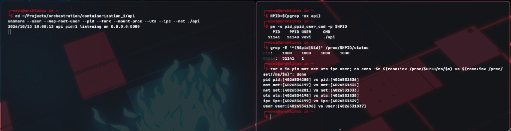

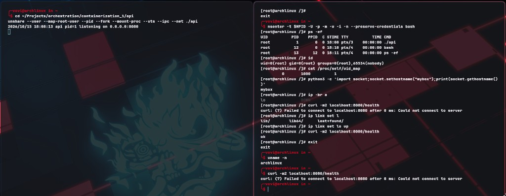

Флаги следующие:

- `user` UID 0 на непривилегированный UID 1000 снаружи;
- `pid` нумерация процессов (API становится PID 1);
- `mount` дерево mount points;
- `uts` изоляция hostname;
- `ipc` изоляция System V IPC и POSIX message queues;
- `net` сетевой стек с интерфейсами, маршрутами и портами.

Флаг `--fork` необходим, потому что иначе вызывающий `unshare` процесс не переходит в новый PID namespace из-за механики наследования. После `fork()` дочерний API становится PID 1. Флаг `--mount-proc` монтирует новый `/proc`, соответствующий PID namespace; иначе `ps` продолжал бы читать список процессов хоста.

## Часть 3 — ограничения cgroup v2

### Ограничение памяти

В опыте использовались:

- `memory.max = 67108864` байт;
- `memory.swap.max = 0`;
- запрос `/eat?mb=100`;
- итоговое событие `oom_kill = 1`.

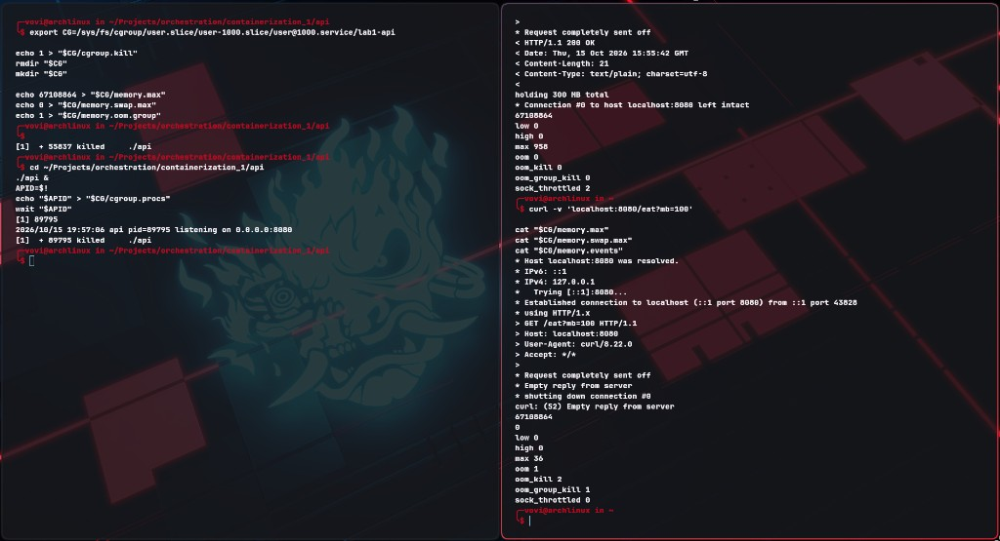

Первоначально `memory.max` ограничивал резидентную память, но `memory.swap.max` оставался равным `max`. OOM не было из-за swap на моем компе. После установки `memory.swap.max = 0` вытеснять страницы стало невозможно: запрос превысил жёсткий лимит, и OOM killer завершил API. В отличие от глобального OOM, этот OOM был ограничен cgroup: жертва выбиралась только среди процессов, входящих в неё, а остальные процессы хоста не затрагивались.

### Ограничение CPU

Значение `cpu.max = 50000 100000` разрешало 50 мс CPU в каждом периоде длительностью 100 мс.

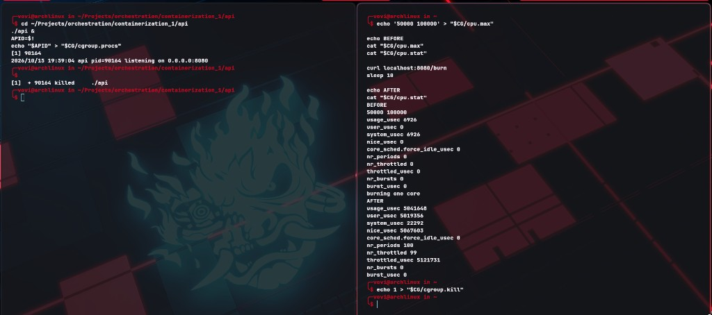

CPU является сжимаемым ресурсом. При `cpu.max = 50000 100000` процессы cgroup могут выполняться 50 мс в каждом периоде 100 мс, то есть получают приблизительно половину ядра. После исчерпания квоты scheduler приостанавливает их до следующего периода вместо завершения. `nr_throttled` показывает число периодов, в которых применялось ограничение, а `throttled_usec` — суммарное время задержки из-за throttling.

### Ограничение числа задач

В опыте использовались:

- `pids.max = 16`;
- `stress-ng --fork 64`;
- достигнутый `pids.peak = 16`;
- ненулевой счётчик `pids.events:max`.

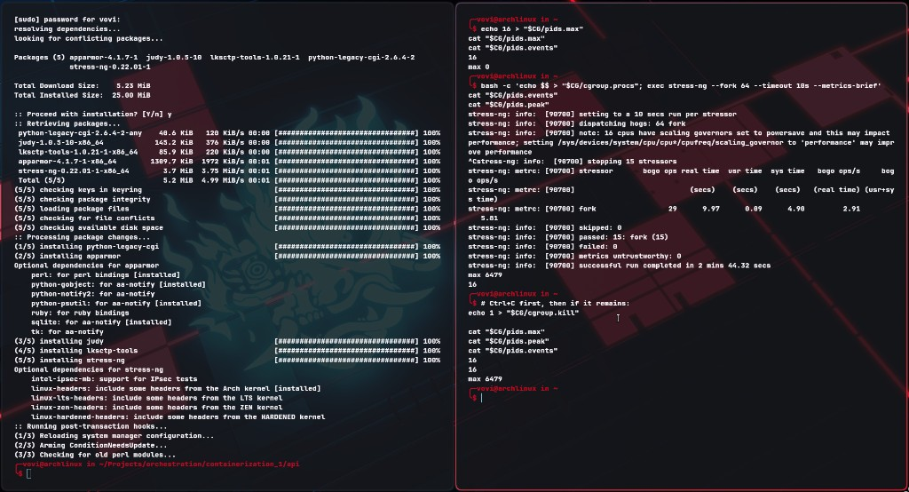

Сначала родительский процесс `stress-ng` был помещён в ограниченную cgroup. Каждый созданный им дочерний процесс автоматически наследовал членство в этой cgroup и увеличивал `pids.current`. После достижения 16 задач ядро отклоняло последующие вызовы `fork()`, а счётчик `pids.events:max` увеличивался. Строка `dispatching hogs: 64` обозначала запрошенное, а не фактически созданное число workers.

## Часть 4 — ограничение привилегий

### Linux capabilities

До удаления capabilities процесс внутри user namespace мог управлять приватным интерфейсом `lo`. После очистки bounding, inheritable и ambient sets операция вернула `EPERM`.

### Seccomp

Файл [`seccomp.profile`](seccomp.profile) содержит raw BPF-фильтр, возвращающий `EPERM` для `uname(2)`. Профиль был создан командой:

```bash
enosys --syscall uname:EPERM --dump=seccomp.profile
```

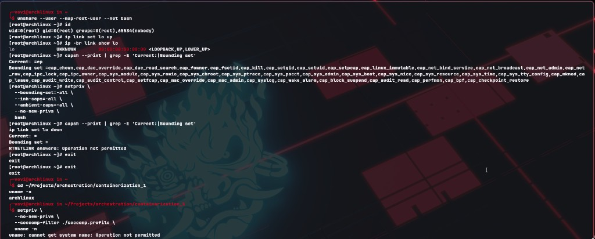

Seccomp применяется до передачи управления реализации syscall в ядре и может полностью запретить конкретную точку входа. Capability проверяется внутри разрешённой операции ядра. Например, netlink-запрос на изменение интерфейса разрешается только при наличии `CAP_NET_ADMIN`.

До `setpriv` root внутри user namespace имел `CAP_NET_ADMIN` относительно принадлежащего ему network namespace и мог поднять приватный `lo`. После очистки capability sets UID оставался равным нулю, но операция завершалась с `EPERM`. Bounding set можно только уменьшать: потомок не может вернуть удалённую capability. Флаг `no_new_privs` наследуется через `fork()` и `execve()`, не снимается и запрещает получать новые привилегии через setuid или file capabilities.

## Часть 5 — VoviDocker

Скрипт [`vovidocker.sh`](vovidocker.sh) выполняет следующие действия:

- создаёт шесть namespace;
- помещает launcher в cgroup до выполнения `fork()`;
- задаёт ограничения памяти, CPU и числа задач;
- поднимает приватный loopback и задаёт hostname `vovidocker`;
- удаляет capabilities и включает `no_new_privs`;
- загружает seccomp-фильтр;
- проверяет `/health` изнутри сетевого namespace;
- удаляет процессы и cgroup при завершении.

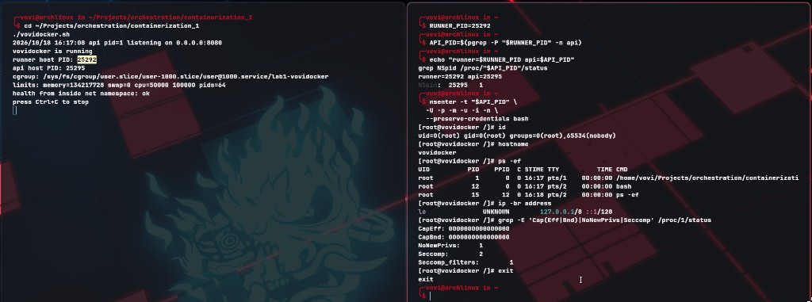

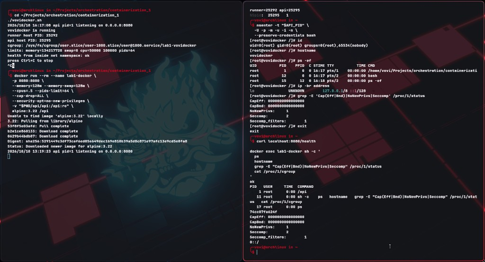

### Сравнение с `docker run`

VoviDocker и Docker создают PID, mount, network, UTS и IPC namespaces, применяют cgroup limits, уменьшают набор capabilities, устанавливают `no_new_privs` и загружают seccomp-фильтр. VoviDocker также явно использует user namespace и отображает root внутри на UID 1000 хоста. На исследованном Docker daemon user namespace remapping по умолчанию не был включён.

VoviDocker не создаёт отдельный rootfs и writable overlay layer, veth pair, bridge, маршрутизацию и NAT/DNAT для публикации порта. В нём также отсутствуют init/reaper, управление LSM и devices, masked kernel paths, volumes, сбор логов и полноценный lifecycle контейнера.

В Docker CLI отправляет запрос daemon `dockerd`. Тот управляет высокоуровневыми объектами и передаёт операцию в `containerd`. `containerd` готовит OCI bundle и запускает долговременный `containerd-shim`, который хранит stdio, exit code и переживает перезапуск daemon. `runc` создаёт namespaces, cgroups, rootfs и ограничения привилегий, запускает процесс и завершает свою работу.

## Часть 6 — образы и хранение данных

Dockerfile находится в [`api/Dockerfile`](api/Dockerfile).

Полученные размеры:

- `lab1-api:builder`: 504 MB;
- `lab1-api:scratch`: 8.42 MB.

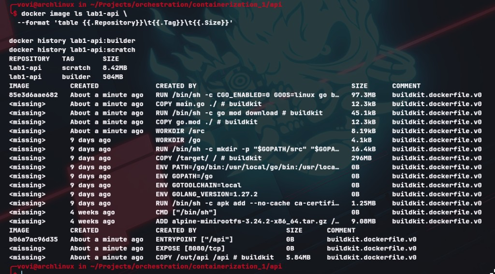

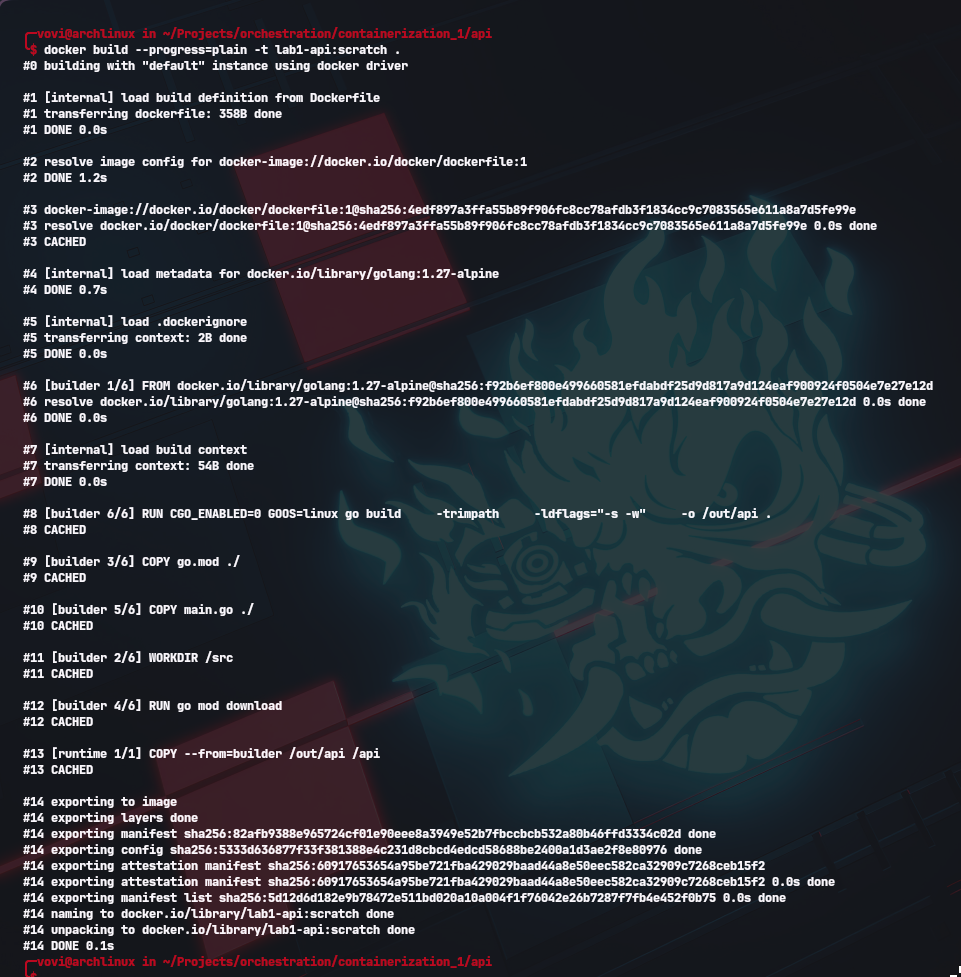

Multi-stage build оставляет компилятор, Alpine и инструменты сборки в стадии `builder`. В финальную стадию из `scratch` копируется только готовый бинарный файл. Поэтому размер уменьшается с 504 MB до 8.42 MB, ускоряется передача образа и сокращается поверхность атаки. `CGO_ENABLED=0` создаёт статически связанный Go-бинарник: Go runtime и требуемый код включены в `/api`, поэтому динамический loader, libc и другие userspace-библиотеки ему не нужны. Системные вызовы по-прежнему обслуживает общее ядро хоста.

При изменении только `main.go` повторно выполняются:

- `COPY main.go ./`;
- `RUN go build ...`;
- `COPY --from=builder /out/api /api`.

Шаги `COPY go.mod ./` и `RUN go mod download` остаются в кэше.

Результаты проверки хранения приведены в
[`screenshots/06-storage-terminal.txt`](screenshots/06-storage-terminal.txt):

- файл `/proof.txt` исчез после пересоздания контейнера;
- файл `/data/proof.txt` сохранился в Docker volume.

Overlayfs объединяет read-only image layers как lower directories и отдельный writable upper directory контейнера в единое merged-представление. Изменение файла из lower layer сначала копирует его в upper layer, после чего меняется копия. Этот copy-on-write слой принадлежит контейнеру и удаляется вместе с ним, поэтому `/proof.txt` исчез. Volume является отдельным Docker-managed хранилищем, монтируемым поверх каталога контейнера. Его жизненный цикл не связан с контейнером, поэтому `/data/proof.txt` сохранился и был подключён к следующему контейнеру.

## Часть 7 — gVisor

Наблюдаемые версии ядра:

- контейнер через runc: `7.2.11-arch1-1`;
- контейнер через runsc: `4.19.0-gvisor`.

Образ `lab1-api:scratch` успешно запускался с `--runtime=runsc`.

При использовании runc приложение выполняет syscall непосредственно в ядро хоста, а namespaces, capabilities, seccomp и LSM ограничивают доступ. В gVisor syscall сначала обрабатывается Sentry — реализацией Linux system interface в userspace. Доступ к файловой системе дополнительно отделён компонентом Gofer. Поэтому большинство syscall приложения не попадает напрямую в соответствующую реализацию ядра хоста, что уменьшает доступную поверхность атаки.

gVisor не эквивалентен виртуальной машине: Sentry не является отдельным гостевым Linux kernel, hardware-virtualized machine отсутствует, а процессы gVisor в конечном счёте используют ядро хоста. Цена дополнительной границы — более высокая стоимость syscall, файловых и сетевых операций, неполная совместимость с редким поведением Linux и дополнительная операционная сложность.

Обычный контейнер всегда разделяет ядро с хостом. Уязвимость в доступной реализации syscall ядра может нарушить контейнерную границу. Именно общий kernel является фундаментальным пределом изоляции обычного контейнера.

## Часть 8 — мониторинг

Стек мониторинга находится в каталоге [`monitoring`](monitoring):

- cAdvisor читает raw cgroup v2;
- Prometheus собирает метрики каждые 5 секунд;
- Grafana отображает подготовленный dashboard;
- `run-monitored-api.sh` сохраняет cgroup после OOM до следующего scrape.

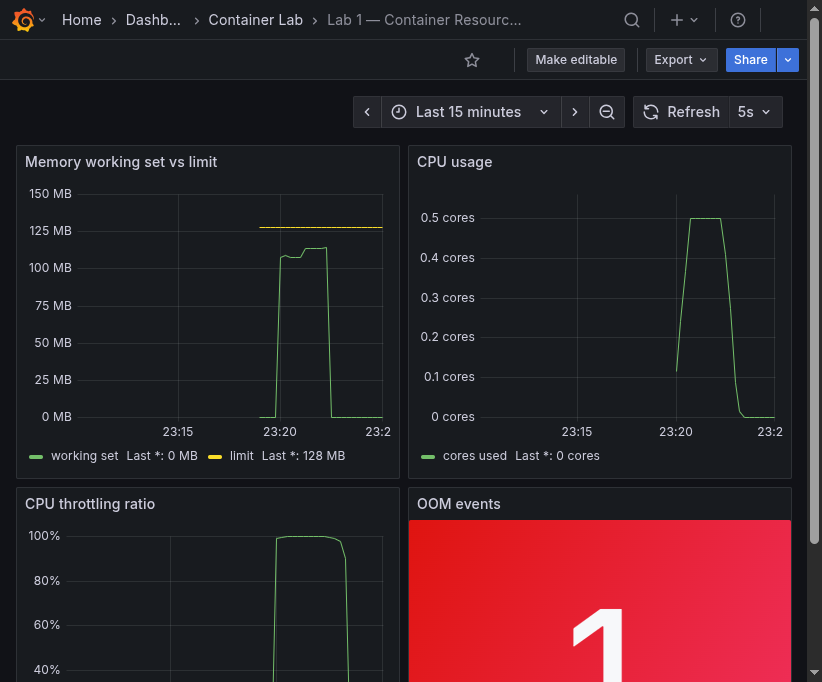

На dashboard отображаются:

- memory working set и `memory.max`;
- использование CPU;
- доля throttled periods;
- количество OOM за последние 15 минут.

### Выбранные алерты

#### `ContainerMemoryNearLimit`

- Условие: working set превышает 85% лимита в течение одной минуты.
- Обнаруживает приближение к `memory.max` до отказа. Это ранний сигнал роста нагрузки или утечки памяти: OOM counter является запаздывающим индикатором и изменяется только после завершения процесса.

#### `ContainerCPUThrottled`

- Условие: более 25% периодов throttled в течение одной минуты.
- Обнаруживает регулярное исчерпание CPU quota. Процесс продолжает получать CPU, но вынужден ждать начала следующего периода, что увеличивает latency без явного падения сервиса. Инженер должен проверить достаточность лимита, интенсивность вычислений и возможность оптимизации нагрузки.

#### `ContainerOOMKilled`

- Условие: увеличение `container_oom_events_total` за пять минут.
- Обнаруживает уже произошедшее принудительное завершение процесса. Инженер должен проверить утечку памяти, размер рабочей нагрузки, корректность `memory.max` и политику перезапуска. В опыте пустая cgroup сохранялась после OOM, потому что при её немедленном удалении событие могло исчезнуть между пятисекундными циклами сбора Prometheus.

## Выводы

1. Контейнер является обычным процессом хоста, а не виртуальной машиной. Его изоляция складывается из нескольких независимых механизмов ядра.
2. Namespaces изменяют видимость ресурсов, но сами по себе не ограничивают их потребление. Для лимитов памяти, CPU и числа задач необходимы cgroups.
3. Память и CPU реагируют на превышение лимита по-разному: память приводит к OOM kill, а CPU — к throttling и росту задержек.
4. UID 0 недостаточно для выполнения привилегированной операции. Capabilities определяют разрешённые привилегированные действия, seccomp ограничивает syscall interface, а `no_new_privs` запрещает последующее повышение привилегий.
5. Образ добавляет отсутствующий в VoviDocker изолированный rootfs. Multi-stage build и `scratch` уменьшают размер и поверхность атаки, но затрудняют интерактивную диагностику из-за отсутствия shell.
6. Writable overlay layer имеет жизненный цикл контейнера и не подходит для постоянных данных. Volume существует отдельно и переживает пересоздание контейнера.
7. Docker автоматизирует veth, bridge, NAT, rootfs, lifecycle и очистку, которые ручной скрипт либо не реализует, либо реализует только в учебном виде.
8. gVisor уменьшает прямую поверхность атаки ядра за счёт userspace kernel, но не создаёт полноценную VM и вносит издержки производительности и совместимости.
9. Метрики cgroup показывают не только уже произошедший OOM, но и приближение к лимиту и скрытый CPU throttling, поэтому позволяют реагировать до заметного отказа сервиса.

## Состав сдаваемых материалов

- исходный код API;
- `api/Dockerfile`;
- `vovidocker.sh`;
- `seccomp.profile`;
- конфигурация мониторинга;
- этот отчёт;
- изображения и терминальные листинги из каталога `screenshots`.
